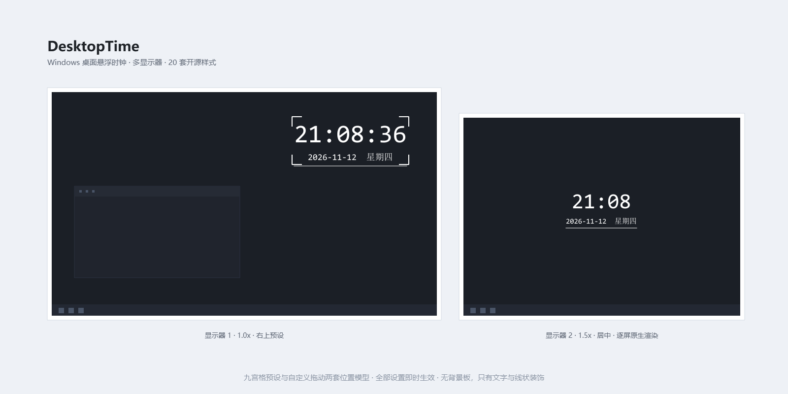
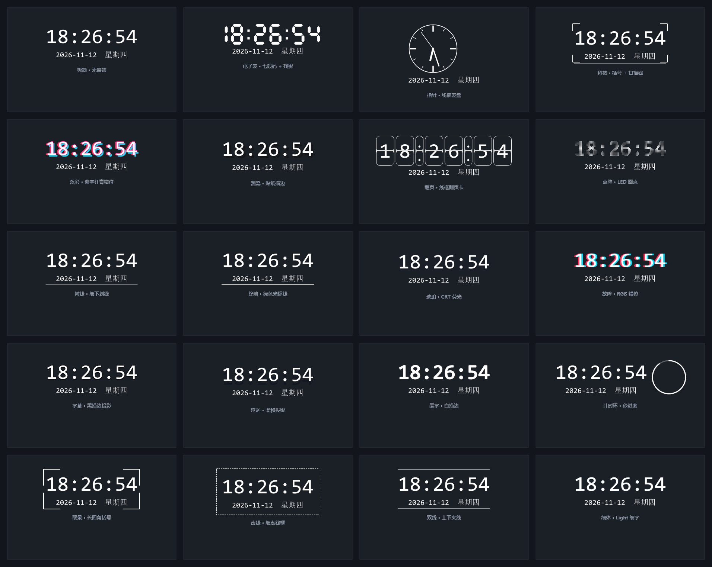
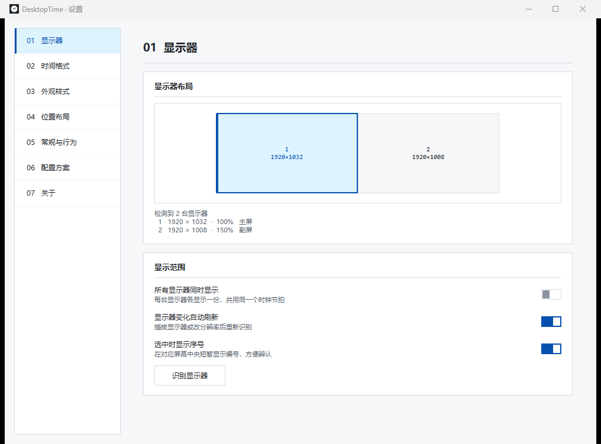

# DesktopTime

Windows 桌面悬浮时钟。多显示器、九宫格预设位置、20 套内置样式、开放样式接口，全部设置即时生效。

基于 **Python 3.12 + PySide6**，界面为黑白 IDE 风（两层底色、零圆角、彩色只表达状态）。



## 特性

- **多显示器**：按显示器 UI 缩略图选择目标屏，支持「所有屏各显示一份」；插拔显示器或改分辨率自动重排；DPI 按 `PER_MONITOR_AWARE_V2` 逐屏适配（1x / 1.25x / 1.5x / 2x 各自原生渲染，不做位图放大，避免放大后字形发虚）。
- **每屏独立样式与位置**：03 / 04 页顶部的下拉框按「序号 · 分辨率」选屏（序号与 01 页一致，就是配置主键）。给某台屏改样式、换预设、调位置，只影响那一台；点一下即生效，切回来就是它原来那份。可一键「应用到全部」，也可「取消单独设置」改回和其他显示器一样。
- **位置**：九宫格 9 个预设锚点（相对桌面永久不变）+ 「自定义拖动」绝对落点，两套互不干扰；可开对齐辅助线、锁定位置。
- **20 套内置样式**：五种渲染模式 —— 字形 `text`、七段码 `segments`、指针表盘 `analog`、翻页卡 `flip`、点阵 `dots`；全部**无背景板**，只有文字 + 线状装饰。
- **开放样式接口** `.dtstyle`：纯数据 JSON，可自定义装饰层（边框 / 描边 / 发光 / 投影 / 分隔线 / 进度环 / 四角括号）与特效（呼吸 / 淡入淡出 / 脉动 / 闪烁）。
- **配置方案**：本地多套配置一键切换，切换前自动快照，可撤销。在方案名上点右键可保存当前设置、另存为、重命名或删除（空白处右键只有「另存为」）。
- **常驻托盘**：关闭窗口可选「最小化到托盘」或「退出」，行为可配置；单实例运行，重复启动只唤醒已有实例。
- **无「确定 / 应用」按钮**：改任何一项立即生效并落盘。

## 20 套内置样式



| 键 | 名称 | 渲染 |
|---|---|---|
| `minimal` | 极简 · 无装饰 | text |
| `lcd` | 电子表 · 七段码 + 残影 | segments |
| `analog` | 指针 · 线描表盘 | analog |
| `tech` | 科技 · 括号 + 扫描线 | text |
| `neon` | 炫彩 · 紫字红青错位 | text |
| `pop` | 潮流 · 贴纸描边 | text |
| `flip` | 翻页 · 线框翻页卡 | flip |
| `matrix` | 点阵 · LED 圆点 | dots |
| `serif` | 衬线 · 细下划线 | text |
| `mono` | 终端 · 绿色光标线 | text |
| `amber` | 琥珀 · CRT 荧光 | text |
| `glitch` | 故障 · RGB 错位 | text |
| `caption` | 字幕 · 黑描边投影 | text |
| `float` | 浮起 · 柔和投影 | text |
| `ink` | 墨字 · 白描边 | text |
| `ring` | 计时环 · 秒进度 | text |
| `frame` | 取景 · 长四角括号 | text |
| `dash` | 虚线 · 细虚线框 | text |
| `twin` | 双线 · 上下夹线 | text |
| `thin` | 细体 · Light 细字 | text |

## 设置界面



七个页签：显示器 / 时间格式 / 外观样式 / 位置布局 / 常规与行为 / 配置方案 / 关于。

## 快速开始

### 直接运行打包版

下载 Release 里的 `DesktopTime.exe`，双击即可，无需安装 Python。

### 从源码运行

```bash
pip install -r requirements.txt
python app.py
```

或双击 `启动 DesktopTime.bat`（Windows，会自动探测本机 Python）。

配置与日志写在 `%APPDATA%\DesktopTime\`：

```
settings.json      当前配置（原子写入）
logs\desktoptime.log
profiles\          配置方案快照
styles\            内置样式投影（.dtstyle，每次启动重写，可作自定义模板）
```

## 样式包接口

自定义样式放进 `%APPDATA%\DesktopTime\styles\*.dtstyle`，在 03 页即可选用。文件名里带 `.dtstyle` 即可被识别，格式：

```json
{
  "schema": "desktoptime.style/v1",
  "name": "我的样式",
  "render": "text",
  "text": { "font": "Consolas", "size": 58, "weight": "Bold", "color": "#FFFFFF" },
  "decorations": [
    { "type": "bracket", "width": 2, "length": 28, "color": "auto", "padding": 10 },
    { "type": "divider", "position": "bottom", "width": 1, "color": "auto", "length": 120 }
  ],
  "effects": [
    { "type": "breath", "duration": 3200, "minOpacity": 0.72 }
  ]
}
```

- 渲染顺序固定：`stack → text → outline → shadow / glow → backdrop → ring → border → effects`，数组顺序即叠放顺序。
- `color: "auto"` 表示跟随文字颜色 —— 用户改字色时边框、括号、虚线框、进度环一起变。
- **纯数据文件**：不执行脚本、不解析表达式、不加载远程 URL、不加载外部字体。
- 上限：8 个装饰 + 4 个特效；动画帧率 ≤ 30fps；不写 `effects` 即无动画。
- 校验不通过时回落内置「极简」，并在 03 页提示一次，不会白屏或崩溃。

完整参数字段见 [docs/style-pack.md](docs/style-pack.md)。

## 目录结构

```
app.py              入口：QApplication、托盘、单实例、控制器装配
tray.py             托盘菜单
core/
  clock.py          时间文本构建（格式 / 日期 / 星期）
  renderer.py       离屏渲染管线：五种渲染模式 + 装饰层 + 特效
  stylepack.py      样式包加载与校验（含 20 套内置预设）
  monitors.py       显示器枚举、DPI、工作区
  controller.py     状态中枢：配置变更 → 广播 → 重绘 / 重定位
  settings.py       默认值与字段校验
  store.py          原子落盘、日志、路径
  profiles.py       配置方案快照与撤销
  single_instance.py  QLocalSocket 单实例
ui/
  theme.py          设计令牌（色值 / 字号 / 间距）
  main_window.py    设置窗口与页签
  pages.py          七个设置页
  screens.py        显示器缩略图控件
  widgets.py        自绘控件（开关 / 九宫格 / 色板）
  clock_window.py   桌面时钟窗口（透明、置顶、点击穿透）
resources/icons/    图标
tests/              单元测试 + 端到端验收脚本
docs/               README 图片与样式包文档
```

## 构建 exe

```bash
pip install pyinstaller
pyinstaller --clean --noconfirm DesktopTime.spec
```

产物在 `dist\DesktopTime.exe`（单文件，约 45 MB）。版本信息与图标由 `version_info.txt` 和 `resources/icons/desktoptime.ico` 提供。

## 测试

```bash
python -m unittest discover -s tests -p "test_*.py"
```

`tests/` 里的 `verify_*.py` 是端到端验收脚本，直接对**打包后的 exe** 验行为（落点偏差、无背景、日期居中、退出无残留进程），需要先构建 exe。

## 已知限制

- 仅 Windows（依赖 `SetProcessDpiAwareness`、分层透明窗口、托盘）。
- 时钟窗口透明且不吃鼠标事件，装饰层的 `shadow` / `glow` 是在离屏位图里画的，不是系统窗口阴影。
- `.dtstyle` 不支持嵌入字体文件，只能用本机已安装字体。

## 许可证

[MIT](LICENSE) © 2026 Clear
